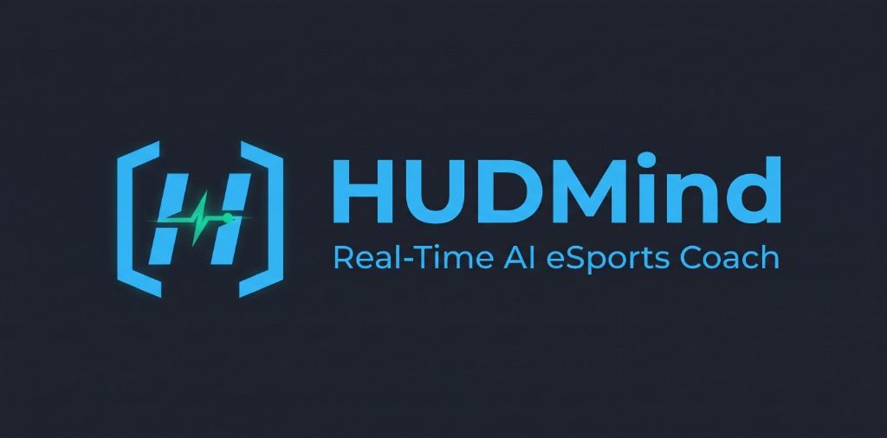

<p align="center">
  
</p>

> 🌐 **Idioma / Language:** [🇪🇸 Español](README.es.md) | **[🇺🇸 English](README.en.md)**

# HUDMind (.NET 9 Native) — Real-Time Tactical Video Game Coach

**HUDMind** is a real-time tactical co-pilot and coach for **Windows 10/11 (x64)** built on **pure .NET 9 + WPF + Win32**, using **0% GPU** (`RenderMode.SoftwareOnly`), **$0 infrastructure cost**, **zero external NuGet packages**, and **100% passive / Anti-Cheat Safe** observation (external GDI capture `GetClientRect` + `PROCESS_QUERY_LIMITED_INFORMATION` + `RegisterHotKey` + official read-only APIs/logs, with zero memory injection or hooking).

---

## Key Features

- **Dual Conversational & Turn-Based Engines:**
  - **Live Conversational (Bidirectional WebSocket):** 16 kHz mic input ↔ 24 kHz native voice output + live screen frames with acoustic echo suppression and smart *barge-in*, compatible with **Gemini Live**, **OpenAI Realtime**, and **xAI Grok Voice**.
  - **Multi-AI Turn Engine (HTTP/2 Keep-Alive + Hedged Vision Racing):** automatic failover across **Gemini**, **Groq (free LPU)**, **OpenAI**, **Claude**, **xAI**, **Mistral**, **OpenRouter**, **Pollinations**, **Airforce**, and local **Ollama** + blind text-only models powered by **Windows WinRT OCR + official Logs/APIs** (`Rocket League`, `VALORANT`, `League of Legends` API `127.0.0.1:2999`, `CS2` and `Dota 2` Valve GSI `127.0.0.1:47315`).
- **3 Independent Communication Modes + Text Chat:**
  - `🎙 Charla`: live microphone (**Open Mic with echo suppression** or **Push-to-Talk** key) + coach voice.
  - `🔊 Solo voz del coach`: microphone off, coach speaks while you can send text chat messages.
  - `💬 Solo texto`: 100% silent, written chat + overlay only.
- **Skill Tier / Rank, Active Role, Event-First Pacing & Measurable Leak Tracking:** adapts depth and vocabulary from *Beginner* to *Pro / GC / Radiant / Faceit 10* in English or Spanish, lets you pick an in-match role (`1v1`, `2v2/3v3`, `Entry`, `AWP`, `Anchor/IGL`, `Jungle`, etc.), switch to **Event-First IGL Pacing** (quiet during routine combat, attempt-based cadence in `training`, `<5 ms` deterministic local alerts, and dead-time briefing cards), and track recurring habits (**Today vs Previous** in `logs/leaks.json`).
- **Personal Local Accounts ($0 Server) + 1–2 Click AI Login:** create or switch isolated player profiles on shared PCs with a **non-repeating alphanumeric Unique ID (`HM-XXXX-XXXX-XXXX`)**, custom emoji badge, accent color, favorite game, optional **PIN lock (PBKDF2-SHA256)**, and portable **AES-256-GCM `.hudmind`** backups; connect your AI effortlessly via **1-click OpenRouter OAuth PKCE** or the **2-click Guided Gemini Live Assistant**.
- **Flexible Hardware Audio, System Tray & Hybrid 0% GPU Overlay:** WinMM microphone and speaker selection, RMS mic test, minimize to **System Tray (Win32 `Shell_NotifyIconW`)** with **named-pipe single-instance bring-to-front**, optional Windows startup (`--minimized`, **disabled by default**), Discord-style translucent **PerMonitorV2** click-through overlay with `WS_EX_TOPMOST` re-assert, **free screen drag (`📌 Move Overlay`)**, and automatic active-monitor tracking (3 styles: *Floating Text*, *Translucent Pill*, *Tactical Card*, `0%–95%` background opacity with 0% GPU crisp shadowed text, `1–3` message mini-feed, live PTT/waveform pill, and `F7` Quick-Chat without Alt-Tab), **Companion Web HUD** over HTTP SSE (2nd screen, **0% GPU LAN QR code** with `?k=` token auth for mobile Wi-Fi, or transparent **`?mode=obs`** URL for OBS Browser Source), assisted **local RCON HUD Bridge** (`127.0.0.1`) for Exclusive Fullscreen compatibility, integrated **`📊 History`** tab (Markdown review reader + CPU leak progress bars), **3-step onboarding wizard**, **system health diagnostics (`🩺 Diagnostics`)**, **live ES/EN GUI i18n**, **focus-scoped hotkey recorder**, **secret-redacted global crash guard**, saved window bounds, non-blocking toasts, and **`📊 Resumen Partida`** post-match reviews.

---

## Bundled Game Profiles (`profiles/`)

| Profile (`game_id`) | Game | Detected Executable | Optional Passive Sensors |
| :--- | :--- | :--- | :--- |
| `universal` | **Any Game (Universal)** | Any foreground game | WinRT OCR + automatic phase detection + loopback WebSocket (`ws://127.0.0.1:49122`, configurable) |
| `rocket_league` | **Rocket League** | `RocketLeague.exe` | Official `Launch.log` (`Freeplay`, `GoalScored`, `LoadMap`) + loopback WebSocket (`ws://127.0.0.1:49122`) + local RCON toast bridge |
| `cs2` | **Counter-Strike 2** | `cs2.exe` | **Official Valve GSI** (`127.0.0.1:47315`) + WinRT OCR + loopback WebSocket (`hudmind:telemetry`) |
| `valorant` | **VALORANT** | `VALORANT-Win64-Shipping.exe` | Official `ShooterGame.log` (`MENU`, `PREGAME`, `INGAME`) + loopback WebSocket (`hudmind:telemetry`) |
| `league_of_legends` | **League of Legends** | `League of Legends.exe` | Official **Riot Live Client API** (`https://127.0.0.1:2999`) + loopback WebSocket |
| `dota2` | **Dota 2** | `dota2.exe` | **Official Valve GSI** (`127.0.0.1:47315`) + loopback WebSocket |
| `aoe2_de` | **Age of Empires II: DE** | `AoE2DE_s.exe`, `AoE2DE.exe` | WinRT OCR + loopback WebSocket |
| `rob_run` | **ROB RUN** | `ROB RUN.exe` | WinRT OCR + loopback WebSocket |

*(For CS2 / Dota 2 GSI, install `gamestate_integration_hudmind.cfg` in 1 click from **🎙 Voz y Ajustes → 🎮 Activar conexión CS2 / Dota 2**).*

- **Full GUI Management (No JSON editing):** add or **edit** AI accounts (custom HTTPS `BaseUrl`, `Vision` vs `Text-Only` override), create or edit **game profiles** (`EXEs`, `Cooldown`, `pHash`, and personal rules), configure local telemetry WebSocket port (`49122`), enable the 1-click local HUD bridge, toggle subtle Win32 audio cues, open saved Markdown reviews (`logs/reviews/`), and get automatic Exclusive-Fullscreen black-screen diagnostics.
- **100% Portable, Encrypted & Auto-Updatable:** local API keys are protected per user with **Windows DPAPI (`crypt32.dll`)**, all 7 profiles and safety rules are sealed inside the AES-256-GCM `HUDMind.Vault.bin` container within the `ReadyToRun` single-file binary, and HUDMind checks **GitHub Releases** on startup (and every 60 min while idle) with **SHA-256** verification and 1-click Setup updates.

---

## Download & Installation (Windows 10/11 x64)

### 1. Which file should I download from Releases? *(You only need one)*

On the **[Releases](https://github.com/Vgarzaniti/HUDmind/releases/latest)** page you will see 4 assets. **You do not need to download all of them** — pick **one `.exe`** based on how you want to run HUDMind:

| File | Best for / When to choose | Needs .NET 9 Runtime? |
| :--- | :--- | :--- |
| **`HUDMind-Setup-win-x64.exe`** ⭐ *(Recommended)* | **Standard Windows installer:** installs per-user (no Admin needed), creates Start Menu shortcut, clean Windows uninstall entry, and enables silent 1-click updates. | ❌ **No** *(bundled)* |
| **`HUDMind.Native-Standalone-win-x64.exe`** | **100% Portable zero-install `.exe`:** double-click and run immediately without shortcuts or Windows install entries. Great for testing or USB drives. | ❌ **No** *(bundled)* |
| **`HUDMind.Native-win-x64.exe`** | **Lightweight build (~26 MB):** same app, intended only for PCs that **already** have [.NET 9 Desktop Runtime](https://dotnet.microsoft.com/download/dotnet/9.0) installed. | ✅ **Yes** *(.NET 9 required)* |
| **`SHA256SUMS.txt`** | `SHA-256` checksum manifest read automatically by the built-in updater. **You do not need to download or run this manually.** | — |

### 2. Step-by-step install & first launch

1. Download **`HUDMind-Setup-win-x64.exe`** from **[Latest Release](https://github.com/Vgarzaniti/HUDmind/releases/latest)** and double-click it.
2. *(Optional — Windows SmartScreen):* because this is an open-source build without a paid code-signing certificate, if Windows shows *"Windows protected your PC"*, click **More info → Run anyway**.
3. Pick the setup language (**English** or **Español**), confirm the destination folder, and choose whether to add an optional Desktop icon. When finished, **HUDMind** launches automatically.
4. Open **🤖 Proveedores IA**, paste a free **Groq** or **Gemini** API key (or configure local **Ollama**), select your microphone/output device, and you're ready to go.

### 3. What exactly does it install on your PC (and what does it NOT)?

- **App binary & uninstaller:** `%LOCALAPPDATA%\Programs\HUDMind\HUDMind.Native.exe` and `unins000.exe` (per-user install via `PrivilegesRequired=lowest`, leaving system-wide `Program Files` untouched by default).
- **Shortcuts & Apps list:** **Start Menu** shortcut (`HUDMind` with `AppUserModelID = HUDMind.Native.Desktop`), optional **Desktop** icon, and a clean **Windows Apps & Features** uninstall entry.
- **Local data, config & reviews (`%LOCALAPPDATA%\HUDMind\`):**
  - `config\accounts.json` *(API keys encrypted per Windows user via **DPAPI** / `crypt32.dll`)*
  - `config\user_config.json` and `config\telemetry.json`
  - `profiles\` *(7 built-in profiles seeded from the sealed vault + your custom rules/profiles)* and `logs\reviews\` *(secret-redacted logs and Markdown post-match reviews)*
  - *(If launching a portable build next to an existing `profiles\` folder or with `HUDMIND_HOME` set, data lives in that folder instead).*
- **What it does NOT install or touch:**
  - **Zero** kernel drivers, **zero** background services, **zero** DLL injection or game memory access, and **zero** edits to game installation folders.
  - **Windows Startup disabled by default:** `HKCU\Software\Microsoft\Windows\CurrentVersion\Run\HUDMind` (`--minimized`) is written only if you explicitly enable the startup checkbox inside the app.

### 4. Updating & uninstalling

- **1-click updates:** HUDMind checks GitHub Releases on launch (and every 60 min while idle), downloads to your chosen folder *(defaulting to Downloads)*, verifies hashes against **`SHA256SUMS.txt`**, and—when installed via Setup (`unins000.exe`)—runs a silent upgrade and relaunches automatically (`⚡ Instalar y Reiniciar`).
- **Clean uninstall:** use **Windows Settings → Apps → HUDMind → Uninstall** (or run `%LOCALAPPDATA%\Programs\HUDMind\unins000.exe`). To also wipe saved configs and match reviews, remove `%LOCALAPPDATA%\HUDMind\`.

---

## Build, Test & Run (`.NET 9`)

```powershell
# 1. Build entire solution (0 warnings / 0 errors)
dotnet build native\HUDMind.sln -c Release

# 2. Cross-platform Core suite (63 tests) + Native Windows suite (21 tests) + WPF smoke
dotnet run --project native\HUDMind.Tests\HUDMind.Tests.csproj -c Release --no-build
dotnet run --project native\HUDMind.Windows.Tests\HUDMind.Windows.Tests.csproj -c Release --no-build
.\native\HUDMind.App\bin\Release\net9.0-windows10.0.19041.0\HUDMind.Native.exe --smoke-startup

# 3. Publish single-file executable (x64, 0% GPU)
dotnet publish native\HUDMind.App\HUDMind.App.csproj -c Release -r win-x64 --no-self-contained -p:PublishSingleFile=true -p:DebugType=None -o dist\native

# Optional for PCs without .NET 9 Desktop Runtime installed (--self-contained):
dotnet publish native\HUDMind.App\HUDMind.App.csproj -c Release -r win-x64 --self-contained true -p:PublishSingleFile=true -p:IncludeNativeLibrariesForSelfExtract=true -p:DebugType=None -o dist\native-standalone
```

You can also launch directly via [HUDMind.bat](HUDMind.bat).

---

## Complete Documentation (Español / English)

| Document | Español (`.es.md`) | English (`.en.md`) |
| :--- | :--- | :--- |
| Main Guide (README) | [README.es.md](README.es.md) | [README.en.md](README.en.md) |
| AI Agent Context (`AGENTS`/`CLAUDE`/`GEMINI`) | [AGENTS.es.md](AGENTS.es.md) | [AGENTS.en.md](AGENTS.en.md) |
| Pull Request & Contribution Guide | [docs/pull_request_guide.es.md](docs/pull_request_guide.es.md) · [CONTRIBUTING.es.md](CONTRIBUTING.es.md) | [docs/pull_request_guide.en.md](docs/pull_request_guide.en.md) · [CONTRIBUTING.en.md](CONTRIBUTING.en.md) |
| Versioning `vN.N.N` & Release Policy | [docs/versioning_and_releases.es.md](docs/versioning_and_releases.es.md) | [docs/versioning_and_releases.en.md](docs/versioning_and_releases.en.md) |
| Technical Architecture (IEEE 42010) | [docs/architecture.es.md](docs/architecture.es.md) | [docs/architecture.en.md](docs/architecture.en.md) |
| Software Requirements (SRS IEEE 29148) | [docs/srs.es.md](docs/srs.es.md) | [docs/srs.en.md](docs/srs.en.md) |
| Test Plan & Report (IEEE 29119) | [docs/test_plan_ieee29119.es.md](docs/test_plan_ieee29119.es.md) | [docs/test_plan_ieee29119.en.md](docs/test_plan_ieee29119.en.md) |
| Game Profiles Guide | [docs/game_profiles_guide.es.md](docs/game_profiles_guide.es.md) | [docs/game_profiles_guide.en.md](docs/game_profiles_guide.en.md) |
| Security Policy | [SECURITY.es.md](SECURITY.es.md) | [SECURITY.en.md](SECURITY.en.md) |

---

## Repository Structure

```text
.
├── .cursor/rules/                  # Automatic rules for Cursor AI
├── .github/
│   ├── ISSUE_TEMPLATE/             # Bilingual Bug Report & Feature Request templates
│   ├── PULL_REQUEST_TEMPLATE.md    # Mandatory PR checklist (type, CI checks, SemVer, security)
│   ├── copilot-instructions.md     # Automatic instructions for GitHub Copilot
│   ├── dependabot.yml              # Monthly GitHub Actions updates
│   └── workflows/
│       ├── ci.yml                  # .NET 9 CI (ubuntu-latest core + windows-latest build/tests/smoke)
│       └── release.yml             # Automated Windows x64 Release (tags v*.*.* or manual + SHA256SUMS)
├── AGENTS.md / CLAUDE.md / GEMINI.md # Instant multi-AI context (+ AGENTS.es.md / AGENTS.en.md)
├── .gitignore                      # Protects .env, config/*.json, custom_rules.md, logs/, bin/obj & dist/
├── HUDMind.bat                     # Windows launcher for the native app
├── native/
│   ├── HUDMind.sln                 # .NET 9 solution
│   ├── HUDMind.Core/               # Models, Config/SSRF/Redaction, Embedded Profiles, Updates, Wire Protocol, Engines
│   ├── HUDMind.Windows/            # GDI Capture, WinMM Audio/Devices, WinRT Natural TTS + OneCore, GSI, OCR, KnownFolders
│   ├── HUDMind.App/                # WPF UI (0% GPU), PerMonitorV2 Overlay, Win32 Tray Icon & Update Banner
│   ├── HUDMind.Packer/             # Build-time AES-256-GCM vault compiler (Profiles + ProtectedAssets -> Vault.bin)
│   ├── HUDMind.Tests/              # Cross-platform Core test suite (63 tests)
│   └── HUDMind.Windows.Tests/      # Win32, WASAPI, GSI, RCON bridge, WS, TLS, DPAPI, IPC, Diagnostics, Startup, Audio & KnownFolders test suite (21 tests)
├── profiles/                       # Game profiles and tactical prompts
├── docs/                           # Bilingual technical documentation (*.es.md and *.en.md)
└── archive/legacy_python/          # Archived legacy Python code after the .NET 9 migration
```
