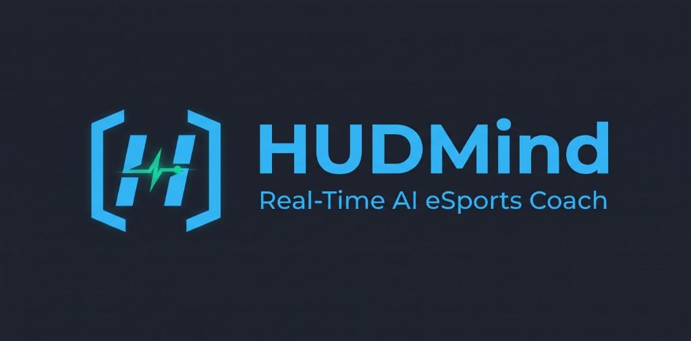

<p align="center">
  
</p>

> 🌐 **Idioma / Language:** **[🇪🇸 Español](README.es.md)** | [🇺🇸 English](README.en.md)

# HUDMind (.NET 9 Native) — Coach Táctico de Videojuegos en Tiempo Real

**HUDMind** es un copiloto y coach táctico en tiempo real para **Windows 10/11 (x64)** construido en **.NET 9 + WPF + Win32 puro**, **0% GPU** (`RenderMode.SoftwareOnly`), **$0 costo de infraestructura**, **cero NuGet externos** y **100% pasivo / Anti-Cheat Safe** (captura GDI externa `GetClientRect` + `PROCESS_QUERY_LIMITED_INFORMATION` + `RegisterHotKey` + APIs/logs oficiales de solo lectura, sin inyección ni lectura de memoria).

---

## Características Principales

- **Doble Motor Conversacional e Instantáneo:**
  - **Live Conversacional (WebSocket bidireccional):** audio 16 kHz ↔ voz nativa 24 kHz + video en vivo con supresión de eco y *barge-in* inteligente, compatible con **Gemini Live**, **OpenAI Realtime** y **xAI Grok Voice**.
  - **Turnos Multi-IA (HTTP/2 Keep-Alive + Hedged Vision Racing):** failover automático entre **Gemini**, **Groq (LPU gratis)**, **OpenAI**, **Claude**, **xAI**, **Mistral**, **OpenRouter**, **Pollinations**, **Airforce** y **Ollama** local + modelos de solo texto alimentados con **Windows WinRT OCR + Logs/APIs oficiales** (`Rocket League`, `VALORANT`, `League of Legends` API `127.0.0.1:2999`, `CS2` y `Dota 2` Valve GSI `127.0.0.1:47315`).
- **3 Modos de Comunicación Separados + Chat Escrito:**
  - `🎙 Charla`: micrófono en vivo (**Mic Abierto con supresión de eco** o **Push-to-Talk** por tecla) + voz del coach.
  - `🔊 Solo voz del coach`: micrófono apagado, el coach te habla y podés escribir por chat.
  - `💬 Solo texto`: 100% silencioso, solo chat escrito y overlay.
- **Calibración por Nivel / Rango, Rol Activo, Modo Eventos Clave e Historial de Fugas:** adapta profundidad y vocabulario desde *Principiante* hasta *Pro / GC / Radiant / Faceit 10* en Español o Inglés, permite elegir tu rol en partida (`1v1`, `2v2/3v3`, `Entry`, `AWP`, `Anchor/IGL`, `Jungla`, etc.), operar en **Ritmo Solo Eventos Clave** (silencio IGL durante acción intensa, feedback por intentos en `training`, alertas locales `<5 ms` determinísticas y tarjetas breves en tiempo muerto), y medir fugas repetidas (**Hoy vs Anterior** en `logs/leaks.json`).
- **Cuentas Locales Personales ($0 Servidor) + Conexión IA en 1–2 Clics:** creá o alterná perfiles independientes en la misma PC con **identificador único irrepetible alfanumérico (`HM-XXXX-XXXX-XXXX`)**, avatar, color, juego favorito, bloqueo opcional por **PIN (PBKDF2-SHA256)** y backups portables cifrados **AES-256-GCM (`.hudmind`)** con **apertura por doble clic en Windows o arrastrando a la ventana**; conectá tu IA sin saber programar con **OpenRouter OAuth PKCE en 1 clic** o **asistente guiado Gemini Live en 2 clics**.
- **Audio Hardware Flexible, Tray y Sistema Overlay Híbrido (0% GPU):** selector de micrófono y salida de audio WinMM, prueba de micrófono con medición RMS, minimización a **Bandeja del Sistema (Win32 `Shell_NotifyIconW`)** con **reactivación de instancia única por Named Pipe**, inicio opcional con Windows (`--minimized`, **desactivado por defecto**), overlay **PerMonitorV2** transparente estilo Discord con re-assert `WS_EX_TOPMOST`, **arrastre libre en pantalla (`📌 Mover Overlay`)** y auto-seguimiento del monitor activo (3 modos: *Solo texto flotante*, *Cápsula* y *Tarjeta*, opacidad `0%–95%` con texto nítido 0% GPU, mini-feed `1–3` mensajes, indicador PTT/ondas en vivo y Quick-Chat `F7` sin Alt-Tab), **Companion Web HUD** por HTTP SSE (2º monitor, **QR en 0% GPU** para abrir en celular por Wi-Fi LAN con token `?k=` o URL transparente **`?mode=obs`** para OBS Browser Source), **puente HUD RCON local** asistido (`127.0.0.1`) para pantalla completa exclusiva, pestaña **`📊 Historial`** (lector Markdown integrado + barras visuales CPU de fugas), **asistente de bienvenida en 3 pasos**, **cartel automático "Qué hay de nuevo"** al actualizar, **diagnóstico del sistema (`🩺 Diagnóstico`)**, **GUI completa ES/EN en vivo** (pestañas, combos, overlay y diálogos), **grabador visual de teclas**, **guardián global de errores con logs redactados**, persistencia de ventana, toasts no bloqueantes, manifiestos `packaging/winget/` y botón **`📊 Resumen Partida`** al finalizar.

---

## Perfiles Incluidos de Fábrica (`profiles/`)

| Perfil (`game_id`) | Juego | Ejecutable Detectado | Sensores Pasivos Opcionales |
| :--- | :--- | :--- | :--- |
| `universal` | **Cualquier Juego (Universal)** | Cualquier juego en foreground | WinRT OCR + detección automática de fase + WebSocket loopback (`ws://127.0.0.1:49122`, configurable) |
| `rocket_league` | **Rocket League** | `RocketLeague.exe` | Log oficial `Launch.log` (`Freeplay`, `GoalScored`, `LoadMap`) + WebSocket loopback (`ws://127.0.0.1:49122`) + puente toast RCON local |
| `cs2` | **Counter-Strike 2** | `cs2.exe` | **Valve GSI oficial** (`127.0.0.1:47315`) + WinRT OCR + WebSocket loopback (`hudmind:telemetry`) |
| `valorant` | **VALORANT** | `VALORANT-Win64-Shipping.exe` | Log oficial `ShooterGame.log` (`MENU`, `PREGAME`, `INGAME`) + WebSocket loopback (`hudmind:telemetry`) |
| `league_of_legends` | **League of Legends** | `League of Legends.exe` | API oficial **Riot Live Client** (`https://127.0.0.1:2999`) + WebSocket loopback |
| `dota2` | **Dota 2** | `dota2.exe` | **Valve GSI oficial** (`127.0.0.1:47315`) + WebSocket loopback |
| `aoe2_de` | **Age of Empires II: DE** | `AoE2DE_s.exe`, `AoE2DE.exe` | WinRT OCR + WebSocket loopback |
| `rob_run` | **ROB RUN** | `ROB RUN.exe` | WinRT OCR + WebSocket loopback |

*(Para CS2 / Dota 2 GSI, podés instalar `gamestate_integration_hudmind.cfg` en 1 clic desde **🎙 Voz y Ajustes → 🎮 Activar conexión CS2 / Dota 2**).*

- **Gestión completa sin tocar JSON:** agregá o **editá** cuentas IA (con `BaseUrl` HTTPS custom y selector de modo `Visión` vs `Solo Texto`), creá o editá **perfiles de juegos** (`EXEs`, `Cooldown`, `pHash` y reglas personales), configurá puerto WebSocket local de telemetría (`49122`), activá el puente HUD local en 1 clic, usá tonos sutiles Win32, abrí tus resúmenes Markdown (`logs/reviews/`) en **`📂 Resúmenes`** y aprovechá diagnóstico automático ante pantallas negras de Fullscreen Exclusivo.
- **100% Portable, Cifrado y Auto-Actualizable:** tus API keys locales se cifran por usuario con **Windows DPAPI (`crypt32.dll`)**, los 7 perfiles y las reglas base vienen sellados en `HUDMind.Vault.bin` (AES-256-GCM) dentro del binario `ReadyToRun` single-file, y al abrir el `.exe` (o cada 60 min en reposo) HUDMind consulta **GitHub Releases** para descargar con **SHA-256** e instalar en 1 clic si usás el Setup.

---

## Descarga e Instalación (Windows 10/11 x64)

### 1. ¿Qué archivo descargar de Releases? *(Solo necesitás uno)*

En la página de **[Releases](https://github.com/Vgarzaniti/HUDmind/releases/latest)** vas a ver 4 archivos. **No hace falta bajar todos**: elegí **un solo `.exe`** según cómo quieras usarlo:

| Archivo | Para quién es / Cuándo elegirlo | ¿Necesita instalar .NET 9? |
| :--- | :--- | :--- |
| **`HUDMind-Setup-win-x64.exe`** ⭐ *(Recomendado)* | **Instalador clásico de Windows:** se instala para tu usuario (sin permisos de Admin), crea acceso directo en Menú Inicio, desinstalador limpio y permite actualizar en 1 clic desde la app. | ❌ **No** *(ya viene incluido)* |
| **`HUDMind.Native-Standalone-win-x64.exe`** | **Portable 100% sin instalación:** doble clic y abre directo sin crear accesos directos ni registro en Windows. Ideal para probar o llevar en pendrive. | ❌ **No** *(ya viene incluido)* |
| **`HUDMind.Native-win-x64.exe`** | **Versión liviana (~26 MB):** mismo programa, pero pensada solo para PCs que **ya** tengan instalado [.NET 9 Desktop Runtime](https://dotnet.microsoft.com/download/dotnet/9.0). | ✅ **Sí** *(requiere .NET 9)* |
| **`SHA256SUMS.txt`** | Archivo de verificación de firmas `SHA-256` que lee automáticamente el actualizador interno. **No hace falta descargarlo ni abrirlo manualmente.** | — |

### 2. Paso a paso para instalar y arrancar

1. Descargá **`HUDMind-Setup-win-x64.exe`** desde **[Latest Release](https://github.com/Vgarzaniti/HUDmind/releases/latest)** y hacé doble clic.
2. *(Opcional — Windows SmartScreen):* como es un proyecto open-source sin certificado comercial pago, si Windows muestra *"Windows protegió su PC"*, tocá **Más información → Ejecutar de todas formas**.
3. Elegí el idioma del instalador (**Español** o **English**), confirmá la carpeta y tildá si querés un ícono extra en el Escritorio. Al finalizar se abre **HUDMind**.
4. En la app, abrí **🤖 Proveedores IA** y pegá una API Key gratuita de **Groq** o **Gemini** (o configurá **Ollama** local), elegí tu micrófono/audio y listo.

### 3. ¿Qué instala exactamente en tu PC (y qué NO)?

- **Programa y desinstalador:** `%LOCALAPPDATA%\Programs\HUDMind\HUDMind.Native.exe` y `unins000.exe` (instalación por usuario vía `PrivilegesRequired=lowest`, sin tocar `Program Files` salvo que elijas modo Admin manualmente).
- **Accesos directos y desinstalación:** acceso directo en el **Menú Inicio** (`HUDMind` con `AppUserModelID = HUDMind.Native.Desktop`), acceso directo opcional en el **Escritorio** y entrada estándar en *Configuración → Aplicaciones* de Windows.
- **Datos, configuración y reseñas locales (`%LOCALAPPDATA%\HUDMind\`):**
  - `config\accounts.json` *(API keys cifradas por usuario con **Windows DPAPI** / `crypt32.dll`)*
  - `config\user_config.json` y `config\telemetry.json`
  - `profiles\` *(7 perfiles base extraídos del vault sellado + tus reglas/perfiles propios)* y `logs\reviews\` *(logs redactados y resúmenes Markdown post-partida)*
  - *(Si ejecutás una versión portable junto a una carpeta `profiles\` propia o definís `HUDMIND_HOME`, los datos se leen/guardan en esa carpeta).*
- **Qué NO instala ni modifica:**
  - **Cero** drivers de kernel, **cero** servicios en segundo plano, **cero** inyección DLL o lectura de memoria en juegos, y **cero** modificación en carpetas de tus videojuegos.
  - **Inicio automático con Windows desactivado por defecto:** solo se registra bajo `HKCU\Software\Microsoft\Windows\CurrentVersion\Run\HUDMind` (`--minimized`) si activás explícitamente el checkbox en la app.

### 4. Cómo actualizar y desinstalar

- **Actualizar en 1 clic:** HUDMind verifica GitHub Releases al abrir (y cada 60 min en reposo), descarga la nueva versión en la carpeta que elijas *(por defecto tu carpeta de Descargas)*, valida el hash contra **`SHA256SUMS.txt`** y, si usás la versión instalada con Setup (`unins000.exe`), aplica la actualización silenciosa y reabre la app automáticamente (`⚡ Instalar y Reiniciar`).
- **Desinstalar:** desde **Configuración de Windows → Aplicaciones → HUDMind → Desinstalar** (o ejecutando `%LOCALAPPDATA%\Programs\HUDMind\unins000.exe`). Para borrar también tu configuración guardada y reseñas, eliminá `%LOCALAPPDATA%\HUDMind\`.

---

## Compilación, Tests y Ejecución (`.NET 9`)

```powershell
# 1. Compilar solución completa (0 warnings / 0 errors)
dotnet build native\HUDMind.sln -c Release

# 2. Suite Core multiplataforma (64 pruebas) + suite nativa Windows (22 pruebas) + smoke WPF
dotnet run --project native\HUDMind.Tests\HUDMind.Tests.csproj -c Release --no-build
dotnet run --project native\HUDMind.Windows.Tests\HUDMind.Windows.Tests.csproj -c Release --no-build
.\native\HUDMind.App\bin\Release\net9.0-windows10.0.19041.0\HUDMind.Native.exe --smoke-startup

# 3. Publicar ejecutable single-file (x64, 0% GPU)
dotnet publish native\HUDMind.App\HUDMind.App.csproj -c Release -r win-x64 --no-self-contained -p:PublishSingleFile=true -p:DebugType=None -o dist\native

# Opcional para PCs sin .NET 9 Desktop Runtime instalado (--self-contained):
dotnet publish native\HUDMind.App\HUDMind.App.csproj -c Release -r win-x64 --self-contained true -p:PublishSingleFile=true -p:IncludeNativeLibrariesForSelfExtract=true -p:DebugType=None -o dist\native-standalone
```

También podés iniciar directamente con [HUDMind.bat](HUDMind.bat).

---

## Documentación Completa (Español / English)

| Documento | Español (`.es.md`) | English (`.en.md`) |
| :--- | :--- | :--- |
| Guía Principal (README) | [README.es.md](README.es.md) | [README.en.md](README.en.md) |
| Contexto para IAs (`AGENTS`/`CLAUDE`/`GEMINI`) | [AGENTS.es.md](AGENTS.es.md) | [AGENTS.en.md](AGENTS.en.md) |
| Guía de Pull Requests y Contribución | [docs/pull_request_guide.es.md](docs/pull_request_guide.es.md) · [CONTRIBUTING.es.md](CONTRIBUTING.es.md) | [docs/pull_request_guide.en.md](docs/pull_request_guide.en.md) · [CONTRIBUTING.en.md](CONTRIBUTING.en.md) |
| Nomenclatura `vN.N.N` y Releases | [docs/versioning_and_releases.es.md](docs/versioning_and_releases.es.md) | [docs/versioning_and_releases.en.md](docs/versioning_and_releases.en.md) |
| Arquitectura Técnica (IEEE 42010) | [docs/architecture.es.md](docs/architecture.es.md) | [docs/architecture.en.md](docs/architecture.en.md) |
| Requisitos de Software (SRS IEEE 29148) | [docs/srs.es.md](docs/srs.es.md) | [docs/srs.en.md](docs/srs.en.md) |
| Plan y Reporte de Pruebas (IEEE 29119) | [docs/test_plan_ieee29119.es.md](docs/test_plan_ieee29119.es.md) | [docs/test_plan_ieee29119.en.md](docs/test_plan_ieee29119.en.md) |
| Guía de Perfiles de Juegos | [docs/game_profiles_guide.es.md](docs/game_profiles_guide.es.md) | [docs/game_profiles_guide.en.md](docs/game_profiles_guide.en.md) |
| Política de Seguridad | [SECURITY.es.md](SECURITY.es.md) | [SECURITY.en.md](SECURITY.en.md) |

---

## Estructura del Repositorio

```text
.
├── .cursor/rules/                  # Reglas automáticas para Cursor AI
├── .github/
│   ├── ISSUE_TEMPLATE/             # Plantillas bilingües de Bug Report y Feature Request
│   ├── PULL_REQUEST_TEMPLATE.md    # Plantilla obligatoria de PR (tipo, checks, SemVer, seguridad)
│   ├── copilot-instructions.md     # Instrucciones automáticas para GitHub Copilot
│   ├── dependabot.yml              # Actualizaciones mensuales de GitHub Actions
│   └── workflows/
│       ├── ci.yml                  # CI .NET 9 (ubuntu-latest core + windows-latest build/tests/smoke)
│       └── release.yml             # Release automática Windows x64 (tags v*.*.* o manual + SHA256SUMS)
├── AGENTS.md / CLAUDE.md / GEMINI.md # Contexto inmediato multi-IA (+ AGENTS.es.md / AGENTS.en.md)
├── .gitignore                      # Protege .env, config/*.json, custom_rules.md, logs/, bin/obj y dist/
├── HUDMind.bat                     # Lanzador Windows de la app nativa
├── native/
│   ├── HUDMind.sln                 # Solución .NET 9
│   ├── HUDMind.Core/               # Modelos, Config/SSRF/Redaction, Embedded Profiles, Updates, Wire Protocol, Motores
│   ├── HUDMind.Windows/            # GDI Capture, WinMM Audio/Devices, WinRT Natural TTS + OneCore, GSI, OCR, KnownFolders
│   ├── HUDMind.App/                # UI WPF (0% GPU), PerMonitorV2 Overlay, Tray Icon Win32 y Banner de Updates
│   ├── HUDMind.Packer/             # Compilador build-time del vault AES-256-GCM (Perfiles + ProtectedAssets -> Vault.bin)
│   ├── HUDMind.Tests/              # Suite de pruebas Core multiplataforma (64 casos)
│   └── HUDMind.Windows.Tests/      # Suite Win32, WASAPI, GSI, puente RCON, WS, TLS, DPAPI, IPC, Diagnóstico, Startup, Audio & KnownFolders (22 casos)
├── packaging/winget/               # Manifiestos WinGet 1.6 listos para publicación
├── profiles/                       # Perfiles de juegos y prompts tácticos
├── docs/                           # Documentación técnica bilingüe (*.es.md y *.en.md)
└── archive/legacy_python/          # Código Python legado archivado tras la migración a .NET 9
```
