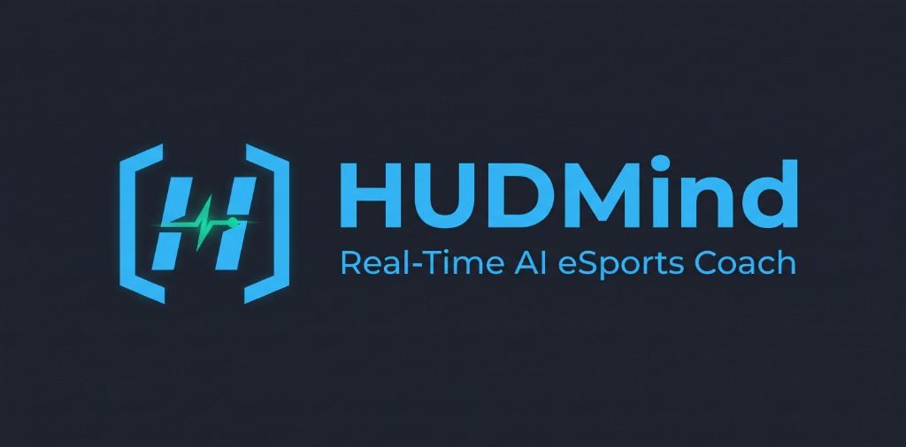

<p align="center">
  
</p>

# HUDMind — Coach Táctico Multimodal de Videojuegos en Tiempo Real (Windows)

**HUDMind (`v0.5.0`)** es un copiloto y coach táctico de videojuegos en tiempo real para **Windows 10/11**, ultra-ligero y 100% pasivo (compatible con motores Anti-Cheat). Observa la ventana activa de tu juego a baja frecuencia, recorta exactamente el área útil del cliente (`GetClientRect` + `ClientToScreen`), filtra frames repetidos en CPU (`pHash` + compuerta pre-captura) para no desperdiciar tokens ni FPS, y te asiste mediante:

- **Overlay transparente *click-through*** (*always-on-top*, 5 temas visuales, sin robar foco ni bloquear el mouse).
- **Voz asíncrona de baja latencia (TTS)** con caché LRU en RAM (`edge-tts` neural, `pyttsx3` offline y `piper`).
- **Enrutador Multi-IA con Rotación Silenciosa y Respaldo Gratuito Automático:** Apilá claves de **Google Gemini** (*Context Caching* 90% ahorro), **Groq Cloud (Gratis)**, **OpenRouter (`:free`)**, **OpenAI (ChatGPT)**, **Anthropic Claude** (*Ephemeral Prompt Caching*), **Pollinations (Gratis)** y **Ollama Local (100% gratis sin login)**. Si una cuenta llega a su límite (`HTTP 429/402`), pasa a la siguiente en el mismo frame **sin interrumpir tu partida**.
- **Dashboard de Estilo de Juego y Uso de IA (Gráficos Circulares `0 a 100%`):** Medidores circulares en vivo de **Rendimiento en tu Última Partida (`0–100%`)**, **Promedio de Últimas Partidas (`0–100%`)**, **Agresividad**, **Paciencia**, **Visión Táctica**, **Economía / Macro** y **Supervivencia**, junto con contadores de **partidas jugadas hoy**, **total histórico desde la instalación** y tabla detallada de **cuánto gastó y ahorró cada modelo IA**.

---

## Juegos Incluidos de Fábrica (Partida Competitiva + Modo Entrenamiento)

| Perfil (`game_id`) | Juego | Ejecutable(s) Detectados | Modo Competitivo (`Match`) | Modo Entrenamiento (`--training-mode`) |
| :--- | :--- | :--- | :--- | :--- |
| `example_cs2` | **Counter-Strike 2** | `cs2.exe` | Economía grupal, timings de C4, utilidad, ángulos y trades. | Aim Botz, recoil patterns, counter-strafing y lineups. |
| `example_valorant` | **VALORANT** | `VALORANT-Win64-Shipping.exe` | Créditos de ronda, economía de habilidades, Ultimate orbs y Spike. | The Range, micro-ajuste de crosshair y timings de strafe. |
| `aoe2_de` | **Age of Empires II: DE** | `AoE2DE_s.exe`, `AoE2DE.exe` | Producción continua de aldeanos, `TC` inactivo, *housed*, recursos flotantes y *counters*. | *Art of War*, *Build Orders* (*Fast Castle*, *Scout Rush*, *Archers*) y lure de jabalí. |
| `rocket_league` | **Rocket League** | `RocketLeague.exe` | Rotación de *Back Post*, prevención de *Double Commit*, pads de boost y *shadow defense*. | *Free Play* y *Custom Training* (*Fast Aerials*, *Half-Flip*, *Speedflip*, *Air Dribble*). |
| `rob_run` | **ROB RUN** | `ROB RUN.exe` | Atracos en *Looty Bay*, nivel de alerta policial/SWAT, extracción a tiempo, *Co-op Revive* y *Surrender*. | Reconocimiento de rutas de escape, blindajes de banco y práctica de hackeo/forzado. |

*(Además podés crear perfiles para cualquier otro juego en 1 clic desde el botón **`+ Nuevo Perfil de Juego`** en la GUI).*

---

## Requisitos Previos

- **Sistema Operativo:** Windows 10 / 11 (x64).
- **Python:** 3.11 o superior (probado en Python 3.13).
- **Video del Juego:** Configurado en **Ventana sin bordes (*Borderless Windowed*)** o **Modo Ventana** para permitir que Windows dibuje el overlay transparente encima del juego.

---

## Instalación Rápida

1. **Crear y activar el entorno virtual:**

```powershell
python -m venv .venv
.\.venv\Scripts\Activate.ps1
```

2. **Instalar dependencias y paquete CLI `hudmind`:**

```powershell
pip install -r requirements.txt
pip install -e .
```

3. **(Opcional) Configurar `.env` o usar directamente la GUI:**

```powershell
Copy-Item .env.example .env
```

---

## Cómo Ejecutar y Probar con un Juego

### 1. Centro de Control Gráfico (`HUDMind.bat` — Recomendado)

Hacé doble clic en [**HUDMind.bat**](HUDMind.bat) o ejecutá:

```powershell
.\.venv\Scripts\hudmind.exe --gui
```

El Centro de Control cuenta con **7 pestañas**:
1. **`Control`**:
   - Elegí entre **Detección automática (`.exe`)** (detecta solo cuando abrís el juego) o **Modo Prueba (YouTube / cualquier ventana)**.
   - Elegí entre **Partida Competitiva (`Match`)** o **Modo Entrenamiento / Práctica (`Training`)**.
   - Botón **`Iniciar y Cerrar GUI (Mínimo RAM)`** para liberar el 100% de la memoria de la ventana de configuración mientras jugás.
   - Botón **`⌨ Configurar Atajos`** para personalizar tus teclas rápidas.
2. **`Cuentas IA & Rotación`**:
   - Botones rápidos de 1 clic: **`+ Gemini`**, **`+ Groq (Gratis)`**, **`+ OpenRouter (:free)`**, **`+ Pollinations (Gratis)`**, **`+ Ollama Local (Gratis)`**, **`+ ChatGPT`**, **`+ Claude`**.
   - Rotación silenciosa automática: si tu Key 1 llega al límite (`HTTP 429`), salta a la Key 2 en esa misma captura sin interrumpirte; si todas tus keys se quedan sin cuota (o si iniciás sin keys), itera automáticamente por el pool gratuito de respaldo.
3. **`Reglas por Juego`**:
   - Escribí tus propias reglas, civilizaciones, agentes o recordatorios para cada juego (se guardan en `profiles/<juego>/custom_rules.md`).
   - Incluye un **Medidor Semáforo en Vivo (`NULO` / `BAJO` / `MODERADO` / `ALTO`)** que te avisa cuántos tokens extra suma tu regla y cómo impacta en el foco táctico de la IA.
4. **`📊 Mi Estilo & Uso IA`**:
   - **Tarjetas Superiores:** Partidas jugadas **hoy**, partidas **totales desde que instalaste el repo**, **tokens totales / frames ahorrados por `pHash`** y **Gasto Real (`$ USD`) vs Ahorro Total (`$ USD`)**.
   - **Gráficos Circulares de Rendimiento (`0 a 100%`):** Círculo de tu **Última Partida** (con calificación `Rango S / A / B / C`) y círculo del **Promedio de tus Últimas 10 Partidas**.
   - **Gráficos Circulares de Estilo de Juego (`0 a 100`):** Cinco anillos dinámicos (**Agresividad**, **Paciencia**, **Visión Táctica**, **Economía / Macro** y **Supervivencia**) + **Diagnóstico automático de tu Arquetipo de Jugador** y filtro por juego.
   - **Tabla de Uso de IA por Modelo y Cuenta:** Muestra consultas exitosas, rotaciones por límite (`429`), consejos dados, tokens de entrada/caché/salida, latencia media (`ms`), gasto real y ahorro por modelo.
   - Botón **`🎮 Simular Partida Demo`** para probar los gráficos circulares en vivo con 1 clic.
5. **`Idioma y Voz`**:
   - Configurá por separado el idioma del **texto en pantalla** (`Español` / `English`) y el de la **voz** (`Español` / `English`), con botón **`🔊 Probar Voz`**.
6. **`Estilo Overlay`**:
   - 5 temas visuales (`cyber-dark`, `minimal-glass`, `high-contrast`, `matrix-green`, `tactical-amber`), posición, opacidad, tipografía y botón **`Vista Previa Overlay`**.
7. **`Rendimiento`**:
   - Modo de eficiencia de tokens (`eco` `896×504`, `balanced` `720p`, `quality`), formato (`JPEG` ultra-rápido o `WebP`), prioridad Windows `BELOW_NORMAL` y **Configurador de Atajos Globales** con botón **`🎹 Capturar Tecla`** (soporta `F1`–`F12`, `A`–`Z`, `0`–`9`, `NUM0`–`NUM9`, teclas especiales y combinaciones con `Ctrl`, `Alt`, `Shift`).

---

### 2. Uso por Consola (CLI)

```powershell
# Detección automática de cualquier juego instalado en profiles/
python -m src.main

# Probar con un juego o video de YouTube específico (--test-mode)
python -m src.main --test-mode --profile rob_run
python -m src.main --test-mode --profile aoe2_de
python -m src.main --test-mode --profile rocket_league
python -m src.main --test-mode --profile example_cs2
python -m src.main --test-mode --profile example_valorant

# Activar Modo Entrenamiento / Práctica
python -m src.main --test-mode --profile rocket_league --training-mode
python -m src.main --test-mode --profile aoe2_de --training-mode

# Probar captura y filtros en CPU sin consumir tokens (--dry-run)
python -m src.main --test-mode --dry-run

# Diagnóstico integral de entorno y benchmarks (--health-check)
python -m src.main --health-check
```

---

## Estructura del Proyecto

```text
.
├── .env.example                 # Plantilla de variables de entorno (incluye HOTKEY_*)
├── .gitignore                   # Protege .env, config/*.json, custom_rules.md, logs y venvs
├── HUDMind.bat                  # Lanzador directo en Windows para el Centro de Control GUI
├── LICENSE                      # Licencia MIT
├── pyproject.toml               # Empaquetado CLI (hudmind v0.5.0) y configuración QA
├── requirements.txt             # Dependencias Python
├── README.md                    # Documentación principal
├── .github/workflows/ci.yml     # Pipeline CI automatizado (GitHub Actions)
├── docs/
│   ├── srs.md                   # Especificación de Requisitos (ISO/IEC/IEEE 29148)
│   ├── architecture.md          # Arquitectura Event-Driven y ADRs (ISO/IEC/IEEE 42010)
│   ├── test_plan_ieee29119.md   # Plan de pruebas, RTM y benchmarks (ISO/IEC/IEEE 29119)
│   └── game_profiles_guide.md   # Guía de perfiles, reglas personalizadas y modo entrenamiento
├── profiles/
│   ├── example_cs2/             # Counter-Strike 2 (Partida + Aim Botz/Lineups)
│   ├── example_valorant/        # VALORANT (Partida + The Range)
│   ├── aoe2_de/                 # Age of Empires II: DE (Macro/Counters + Art of War)
│   ├── rocket_league/           # Rocket League (Rotaciones/Boost + Free Play)
│   └── rob_run/                 # ROB RUN (Atracos/Extracción en Looty Bay + Reconocimiento)
├── src/
│   ├── main.py                  # Orquestador principal asyncio, diagnóstico y CLI
│   ├── config/
│   │   ├── settings.py          # Configuración tipada, redacción de secretos y métricas
│   │   ├── user_store.py        # Persistencia atómica (0o600) de cuentas IA y preferencias
│   │   ├── telemetry.py         # Telemetría de gasto/tokens IA, partidas y estilo 0-100%
│   │   └── hotkeys.py           # Hotkeys globales Win32 RegisterHotKey configurables
│   ├── capture/
│   │   ├── base.py              # Interfaz CaptureStrategy y modelos de frame
│   │   ├── mss_capture.py       # MSSCaptureStrategy (zero-copy + recorte cliente activo)
│   │   └── observer.py          # ScreenObserver (Pub/Sub Drop-Oldest + compuerta pre-captura)
│   ├── pipeline/
│   │   ├── filters.py           # Chain of Responsibility (Focus, Cooldown, pHash, Eco 896x504)
│   │   └── schemas.py           # Structured Outputs, State Machine y memoria anti-repetición
│   ├── profiles/
│   │   └── loader.py            # Detector Win32 + cargador de perfiles y custom_rules.md
│   ├── ai/
│   │   ├── gemini_client.py     # Context Caching, thinking_budget=0 e inferencia Gemini
│   │   └── providers.py         # Enrutador Multi-IA con rotación silenciosa y auto-fallback
│   ├── output/
│   │   ├── overlay.py           # Overlay transparente click-through (5 temas + DPI Aware v2)
│   │   └── tts.py               # Motor TTS con caché LRU en RAM (EdgeTTS / Pyttsx3 / Piper)
│   └── ui/
│       └── gui.py               # Centro de Control GUI (7 pestañas + gráficos circulares 0-100%)
└── tests/                       # Suite de 31 pruebas unitarias, seguridad e integración
```

---

## Documentación Técnica (Estándares ISO / IEEE)

- [docs/srs.md](docs/srs.md): Especificación de Requisitos de Software (**ISO/IEC/IEEE 29148**, **ISO/IEC 25010**, **ISO/IEC 27001**).
- [docs/architecture.md](docs/architecture.md): Arquitectura Técnica (**ISO/IEC/IEEE 42010**), diagramas, concurrencia y 11 ADRs.
- [docs/test_plan_ieee29119.md](docs/test_plan_ieee29119.md): Plan y Reporte de Pruebas (**ISO/IEC/IEEE 29119 / IEEE 829**), matriz RTM y benchmarks en Windows 11.
- [docs/game_profiles_guide.md](docs/game_profiles_guide.md): Guía de creación de perfiles, reglas personalizadas con medidor de impacto y modo entrenamiento.
